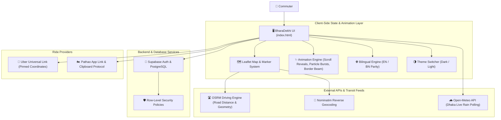

# 🚖 BharaDekhi — Dhaka Multi-Modal Transit Planner & Fare Engine

[](https://bharadekhi.vercel.app/)
[](https://developer.mozilla.org/en-US/docs/Web/JavaScript)
[](https://tailwindcss.com/)
[](https://leafletjs.com/)
[](https://supabase.com/)

An advanced, interactive multi-modal transit route planner, real-time fare estimator, and ride-hailing launcher engineered specifically for commuters in Dhaka, Bangladesh. 

BharaDekhi solves Dhaka's commuting uncertainty by unifying road routing, peak-hour traffic surge modeling, live weather adjustments, metro rail feeder optimization, local bus networks, and direct app deep-linking into a single, high-performance web platform.

---

## 🔗 Quick Links
* **Live Web App:** [https://bharadekhi.vercel.app/](https://bharadekhi.vercel.app/)
* **Developer Portfolio:** [https://bharadekhi.vercel.app/about.html](https://bharadekhi.vercel.app/about.html)
* **Interactive FAQ & Help Center:** [https://bharadekhi.vercel.app/faq.html](https://bharadekhi.vercel.app/faq.html)
* **Developer LinkedIn:** [Amiyo Hasan](https://www.linkedin.com/in/amiyo-hasan-6729873a7/)
* **Developer GitHub:** [@AmiyoTheAnalyst](https://github.com/AmiyoTheAnalyst)

---

## 🌟 Core Features & Implementation Highlights

### 1. 🗺️ Geospatial Routing & Automated Trip Simulation
* **Interactive Vector Mapping:** Built on [Leaflet.js](https://leafletjs.com/) and OpenStreetMap cartography, customized with high-contrast road styling and theme-reactive tile management (Dark / Light mode).
* **Live Road Distance Calculation:** Integrated with the public **OSRM (Open Source Routing Machine)** driving API, delivering exact road polyline geometries and driving durations.
* **Algorithmic Haversine Fallback:** Resilient mathematical routing layer ensuring continuous operation even during external network or API interruptions.
* **Automated Route Animation:** Automated smooth playback along the route with dynamic vehicle icon heading rotation, speed throttling, automated camera panning, and play/pause controls.
* **Tap-to-Set Map Coordinates & GPS Geolocation:** Commuters can tap anywhere on the Dhaka map or use HTML5 browser geolocation. The application resolves nearby landmark and street names using OpenStreetMap's Nominatim reverse-geocoding API.

### 2. ⚡ Dynamic Surge Multiplier & Real-Time Weather Radar
* **Time-Aware Peak Surge Engine:** Tracks local Dhaka time (`Asia/Dhaka`) to detect morning (8:30 AM – 10:30 AM) and evening (5:00 PM – 8:00 PM) peak windows, applying a calibrated 1.4x – 2.2x surge multiplier.
* **Animated Surge Tachometer:** Custom radial gauge visualization indicating real-time traffic surge pressure (Normal, Moderate, High Surge).
* **Live Precipitation Polling:** Periodically queries the [Open-Meteo Weather API](https://open-meteo.com/) for central Dhaka precipitation. When rain is detected, the engine dynamically applies an automated 30%–50% rain fare uplift to ride-hailing and feeder legs. Includes manual override controls.

### 3. 🚆 Interactive “More Ways to Travel” Public Transit Comparison
* **Compact Transit Comparison Cards:** Positioned immediately below direct ride options (Bike, CNG, Car), providing commuters with high-contrast, side-by-side comparison cards for **Metro Rail** and **Local Bus**.
* **Conditional Journey Planner Rendering:** Detailed route planners remain neatly collapsed by default to eliminate visual clutter. Selecting "View Metro Route" or "View Bus Routes" smoothly reveals the full dark navy journey dashboard with station timelines, feeder combinations, and stop intersections.
* **Synchronized Dynamic Mapping:** Selecting a public transit mode dynamically switches the map view from direct road lines to illuminated MRT Line 6 track segments, station badges, or bus corridors with dashed first/last-mile feeder connections. Returning to direct ride options immediately restores the driving polyline.
* **Synchronized Real-Time State:** Every change to pickup or destination automatically updates fares, durations, and stations across the comparison cards and active portals without page reloads.

### 4. 🚇 MRT Line 6 Hybrid Light-Path Viaduct
* **Interactive 16-Station Light-Path:** Custom visual viaduct track representing MRT Line 6 from Uttara North to Motijheel, featuring an illuminated active transit segment and an animated train cruising beacon (`🚅 METRO`).
* **Multi-Modal Feeder Optimization:** Calculates first-mile and last-mile access to and from metro stations, comparing rickshaw, bike, and CNG options to highlight the most cost-effective combination.
* **Rickshaw Bargaining Model:** Emulates authentic Dhaka bargaining dynamics (Base ৳20 + ৳12/km, rounded up to the nearest ৳10; peak hours add ৳10 to the upper bargaining limit while preserving base rates).
* **MRT Pass Discount:** Built-in 10% discount toggle for MRT Pass / Rapid Pass holders.

### 5. 🚌 Dhaka Local Bus & Feeder Journey Planner
* **Transit Graph Resolver:** Connects origin and destination hubs with direct Dhaka bus routes and multi-modal hybrid feeder suggestions.
* **BRTA Fare Policy Emulation:** Models Bangladesh Road Transport Authority fare rules (৳2.45/km with ৳10 non-AC and ৳20 AC minimums).

### 6. 🚀 One-Tap Ride-Hailing Deep Links & Particle Bursts
* **Uber Universal Deep-Linking:** Automatically constructs `m.uber.com/ul/` deep-links with pre-pinned pickup and drop-off GPS coordinates.
* **Pathao Native App Launcher:** Opens the Pathao mobile app and synthesizes clipboard ride instructions (pickup, destination, vehicle mode, and estimated fare).
* **Haptic Particle Burst Physics:** Interactive particle burst explosion physics on action buttons providing tactile, responsive feedback.

### 7. 🎨 Advanced UI, Motion & Animation Architecture
* **Dark Navy Transit Dashboard:** High-contrast aesthetic with deep navy gradients, illuminated cyan and emerald accents, and glowing badges.
* **Conic "Border Beam" Glow:** Rotating conic-gradient illumination highlighting the best-value travel option.
* **Aurora Ambient Backdrops:** Multi-layer animated radial glows and subtle gradient blurs creating futuristic visual depth.
* **Fluid Sliding Pill Tabs:** Segmented tab controls utilizing `cubic-bezier(0.34, 1.56, 0.64, 1)` spring physics.
* **Scroll-Triggered Reveals:** Restrained 400ms fade-and-slide section reveals powered by the `IntersectionObserver` API.
* **Staggered Fare Cards:** Staggered visual entrance delays (40ms, 110ms, 180ms) and pop refresh animations on price updates.
* **Smooth FAQ Accordion:** CSS Grid expansion (`grid-template-rows: 0fr -> 1fr`) with animated closure transitions.
* **Transit Constellation Map:** SVG vector network with continuous `<animateMotion>` vehicle tracking.
* **Accessibility First:** Full automatic adherence to `prefers-reduced-motion: reduce`.

### 8. 🌐 Zero-Layout-Shift Bilingual System & Themes
* **Size-Parity Localization:** Instant switching between English and Bangla across the entire platform without layout breaks, text wrapping, or viewport expansion.
* **Synchronized Dark / Light Themes:** Dual-palette system with persistent `localStorage` preference and synchronized map tile styling.

### 9. 🔐 Supabase Authentication & Admin Control Center
* **Central User Authentication:** Supabase Auth handling secure sign-up, sign-in, and password management.
* **PostgreSQL Row-Level Security (RLS):** Database-level access control policies ensuring non-admin users only access their own profiles.
* **Admin Dashboard:** Verified admin control center for viewing registered user metrics and platform accounts.

---

## 🛠️ Skills, Tools & Technologies Used

| Domain | Technologies & Tools |
| :--- | :--- |
| **Frontend Engineering** | Vanilla JavaScript (ES6+), HTML5, Modern CSS3, CSS Custom Properties |
| **UI Styling & Design Systems** | [Tailwind CSS](https://tailwindcss.com/), [Lucide Icons](https://lucide.dev/), Glassmorphism, Conic Gradients |
| **Motion & Animation** | CSS `@keyframes`, GPU-accelerated `transform`, SVG `<animateMotion>`, CSS Grid Accordions |
| **Geospatial & Mapping** | [Leaflet.js](https://leafletjs.com/), OpenStreetMap, [OSRM API](https://project-osrm.org/), Nominatim Geocoding |
| **Real-Time Data & APIs** | [Open-Meteo Weather API](https://open-meteo.com/), `Asia/Dhaka` Clock Engine, REST APIs |
| **Backend & Database** | [Supabase](https://supabase.com/), PostgreSQL, Row-Level Security (RLS), Database Triggers |
| **Performance & A11y** | `IntersectionObserver API`, `prefers-reduced-motion`, Zero-Layout-Shift Typography |
| **DevOps & Tooling** | Vercel (CI/CD Automated Deployment), Git, GitHub, Postman API Testing |

---

## 🏗️ Architecture & Data Flow



---

## 📐 Fare Calculation Logic & Modes

Baseline rates calibrated for Dhaka road conditions:

| Vehicle Mode | Base Fare | Per-KM Rate | Speed (Peak / Off-Peak) | Surge Modeling |
| :--- | :--- | :--- | :--- | :--- |
| **🏍️ Bike** | ৳30 | ৳14 / km | 18 km/h / 24 km/h | 1.4x – 2.2x Peak · +30%–50% Rain |
| **🛺 CNG** | ৳50 | ৳18 / km | 12 km/h / 18 km/h | 1.4x – 2.2x Peak · +30%–50% Rain |
| **🚗 Car (Sedan)** | ৳80 | ৳24 / km | 15 km/h / 22 km/h | 1.4x – 2.2x Peak · +30%–50% Rain |
| **🚇 MRT Line 6** | ৳20 min | ৳5 / km (max ৳100) | 2 min/station + 5 min wait | Fixed fare chart · 10% Pass Discount |
| **🚌 Local Bus** | ৳10 min (Non-AC) | ৳2.45 / km | BRTA Draft Table | Fixed per-km fare |

*Estimates are illustrative baseline calculations and independent of live dynamic pricing set by ride-hailing operators.*

---

## 🚀 Running Locally

1. **Clone the repository:**
   ```bash
   git clone https://github.com/AmiyoTheAnalyst/BharaDekhi.git
   cd BharaDekhi
   ```

2. **Start a local development server:**
   ```bash
   # Using Python 3
   python -m http.server 8000

   # Or using Node.js npx
   npx serve .
   ```

3. Open **`http://localhost:8000`** in your browser.

---

## 👨‍💻 Developer & Verified Profiles

**Amiyo Hasan**  
*Creator of BharaDekhi · Full-Stack Software Engineer & Web Developer*  
*B.Sc. in Computer Science & Engineering (B.Sc. CSE), BRAC University, Dhaka, Bangladesh*

* **Portfolio:** [https://bharadekhi.vercel.app/about.html](https://bharadekhi.vercel.app/about.html)
* **LinkedIn:** [https://www.linkedin.com/in/amiyo-hasan-6729873a7/](https://www.linkedin.com/in/amiyo-hasan-6729873a7/)
* **GitHub:** [https://github.com/AmiyoTheAnalyst](https://github.com/AmiyoTheAnalyst)
* **Email:** [amiyohasan23@gmail.com](mailto:amiyohasan23@gmail.com)

---

## 📄 License & Attribution
* **License:** Released for Dhaka commuters under standard open web practices.
* **Map Data:** © [OpenStreetMap](https://www.openstreetmap.org/copyright) contributors.
* **Routing:** Powered by [Project OSRM](https://project-osrm.org/).
* **Weather Data:** Provided by [Open-Meteo.com](https://open-meteo.com/) under [CC BY 4.0](https://creativecommons.org/licenses/by/4.0/).
