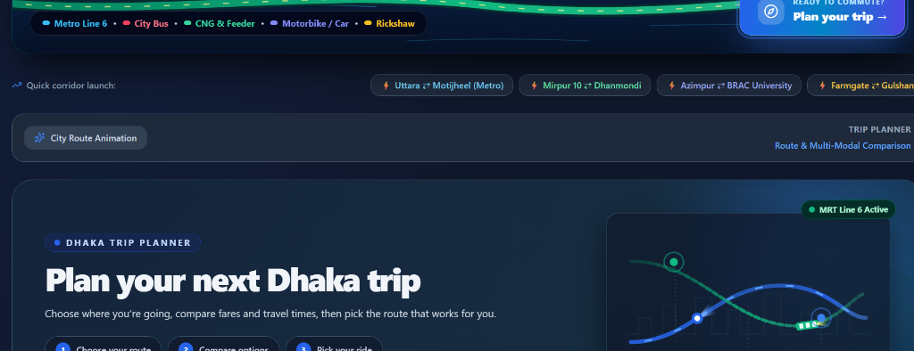
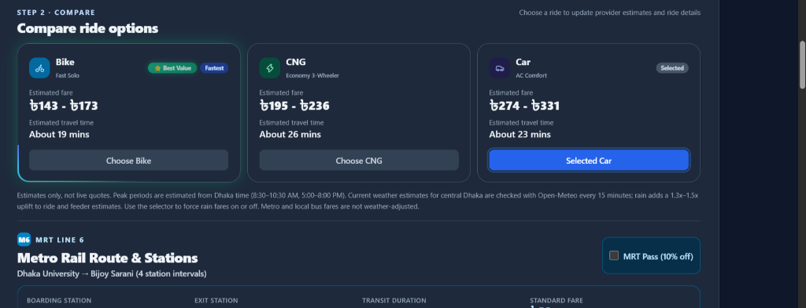
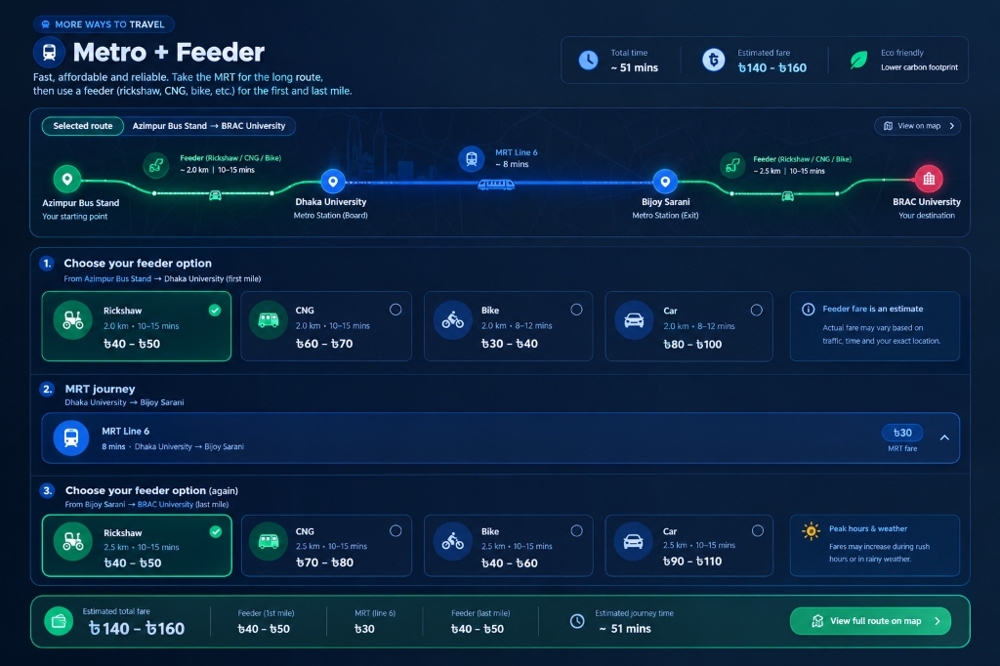
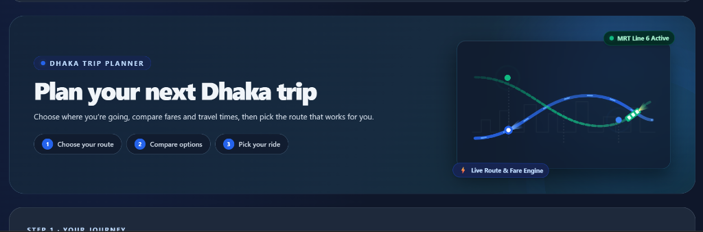
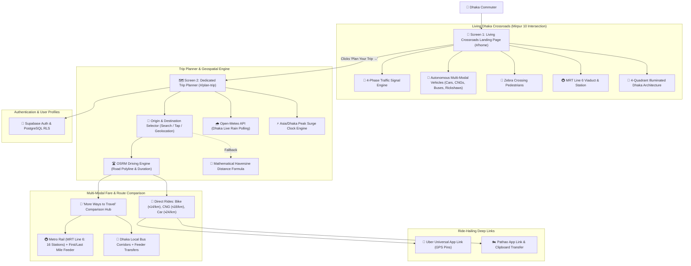

# 🚖 BharaDekhi — Dhaka Multi-Modal Transit Planner & Living City Simulator

[](https://bharadekhi.vercel.app/)
[](https://developer.mozilla.org/en-US/docs/Web/JavaScript)
[](https://tailwindcss.com/)
[](https://leafletjs.com/)
[](https://supabase.com/)

> **BharaDekhi** (ভাড়া দেখি) is a production-grade, Dhaka-tailored multimodal transportation planning, fare estimation, and living city simulation web platform. It eliminates urban commuting friction by bridging direct ride-hailing options (Bike, CNG, Car) with public transit networks (MRT Line 6 Metro Rail, Local City Buses, and first/last-mile feeder connections).

---

## 🔗 Quick Links

* 🌐 **Live Web Application:** [https://bharadekhi.vercel.app/](https://bharadekhi.vercel.app/)
* 👨‍💻 **Developer Portfolio:** [https://bharadekhi.vercel.app/about.html](https://bharadekhi.vercel.app/about.html)
* ❓ **Interactive FAQ & Help Center:** [https://bharadekhi.vercel.app/faq.html](https://bharadekhi.vercel.app/faq.html)
* 💼 **Developer LinkedIn:** [Amiyo Hasan](https://www.linkedin.com/in/amiyo-hasan-6729873a7/)
* 🐙 **GitHub Repository:** [https://github.com/AmiyoTheAnalyst/BharaDekhi](https://github.com/AmiyoTheAnalyst/BharaDekhi)

---

## 📸 Application Interface & Visual Showcase

### 1. Living Dhaka Crossroads Animated Landing Page
*An authentic, continuously simulated 2.5D miniature intersection of the Mirpur 10 roundabout, complete with autonomous vehicles, coordinated 4-phase traffic lights, pedestrian crossings, elevated Metro Rail, and illuminated Dhaka skyline.*



### 2. "More Ways to Travel" Multi-Modal Public Transit Comparison
*Side-by-side comparison cards for Metro Rail and Local Bus, detailing the lowest estimated total route fares (including first-and-last-mile feeders) and estimated transit durations.*



### 3. Detailed Metro + Feeder Journey Planner
*Interactive journey timeline displaying boarding/exit stations, station intervals, transit duration, feeder options (Rickshaw, CNG, Bike, Car), and synchronized map route projections.*



### 4. Direct Ride Comparison & Real-Time Surge Multipliers
*Direct ride options with animated glowing halo selection states, peak-hour surge gauge, and live weather adaptation.*



---

## 🏙️ Problem Statement & Motivation

Dhaka is one of the world's most densely populated megacities, characterized by complex, multi-tiered urban transport options. Commuters daily navigate:
1. **Unpredictable Fare Spikes:** Arbitrary ride-hailing surge rates during monsoon rainstorms and rush hours.
2. **Fragmented Transit Information:** Metro Rail (MRT Line 6) operates reliably, but commuters struggle to evaluate whether taking the metro with feeder connections (rickshaws, CNGs, bikes) is cheaper or faster than taking a direct ride.
3. **Complex First/Last-Mile Bargaining:** Traditional rickshaw and auto-rickshaw fares lack transparency and vary drastically based on distance and weather.
4. **Information Asymmetry:** Lack of unified comparisons between direct vehicle hires, metro viaduct routes, and regional city bus corridors.

**BharaDekhi solves this** by creating a single, interactive platform that calculates, compares, and visualizes all available ways to travel from any Dhaka pickup point to any destination.

---

## ✨ Key Features & Technical Capabilities

### 1. 🌆 Screen 1: Living Dhaka Crossroads (2.5D Miniature Intersection)
* **Dedicated Landing Experience (`#/home`):** Immediately welcomes authenticated users with a full-screen, living miniature simulation of Dhaka's iconic Mirpur 10 Crossroads.
* **4-Phase Coordinated Signal Logic:** Authentic Dhaka traffic light cycles (North-South Green ➔ North-South Yellow ➔ East-West Green ➔ East-West Yellow) reflected via live SVG signal heads and an interactive top-right HUD badge.
* **Autonomous Multi-Modal Traffic:** Dynamic, autonomous vehicles (Dhaka local buses, private sedans, CNG auto-rickshaws, motorbikes, and footed rickshaws) that intelligently accelerate on green, slow down on yellow, stop at red halt bars, maintain safety queue spacing, and yield at crossings.
* **Synchronized Pedestrian Crossings:** Pedestrians walk across zebra crossings during perpendicular red signals and safely wait on sidewalks during green flows.
* **Elevated MRT Line 6 Viaduct & Train:** Elevated railway track crossing the intersection with an animated cruising metro train entering and exiting the illuminated Mirpur 10 station.
* **Illuminated 4-Quadrant City Architecture:** Handcrafted SVG architectural skyline across Northwest, Northeast, Southwest, and Southeast quadrants featuring iconic Dhaka landmarks (Mirpur Plaza, Bangla Tech, Sonali Jewelers, Dhaka Book Depot, Janata Pharmacy clinic with green cross, rooftop water tanks marked `TANK`, TV aerials, and pulsing aircraft hazard beacons).
* **Two-Screen SPA Navigation:** Seamlessly transitions to the Trip Planner via a floating, bottom-right **"Plan Your Trip →"** CTA button or quick corridor launch pills.

### 2. 🗺️ Screen 2: Dedicated Dhaka Trip Planner (`#/plan-trip`)
* **Flexible Coordinate Input:** Commuters can type street/area names, click quick corridor presets (e.g., *Uttara ⇄ Motijheel*, *Mirpur 10 ⇄ Dhanmondi*, *Azimpur ⇄ BRAC University*), tap anywhere on the Leaflet map, or use HTML5 browser geolocation.
* **OSRM Road Distance & Driving Routing:** Integrates directly with the Open Source Routing Machine (OSRM) driving API to extract precise road geometries, polyline coordinates, and real-world travel durations.
* **Mathematical Haversine Fallback:** Zero-downtime routing resiliency: if external network APIs face latency or limits, an internal Haversine trigonometric engine maintains uninterrupted fare computation.
* **Interactive Route Animation Playback:** Dynamic vehicle marker animates smoothly along the calculated road polyline with automated heading rotation and camera tracking.

### 3. 🚆 "More Ways to Travel" Public Transit Comparison Hub
* **Side-by-Side Public Transport Cards:** Compact comparison cards for **Metro Rail** and **Local Bus** displayed directly below direct ride cards.
* **Total Route Fare Calculation:** Unlike basic tools that only show station-to-station ticket prices, BharaDekhi computes the **lowest total route fare**, combining metro tickets with necessary first-mile and last-mile feeder rides.
* **Conditional Journey Dashboard:** Detailed timelines remain neatly collapsed by default to prevent visual fatigue, smoothly expanding when the user selects "View Metro Route" or "View Bus Routes".
* **Interactive Feeder Selector:** Commuters can choose feeder vehicles (Rickshaw, CNG, Bike, Car) for both the first mile (pickup ➔ boarding station) and last mile (exit station ➔ destination), instantly recalculating the total journey cost and travel time.
* **Synchronized Map Switcher:** Selecting Metro Rail or Bus dynamically updates the Leaflet map from direct road polylines to station light-paths, station radius markers, and dashed feeder paths.

### 4. ⚡ Dynamic Surge Multiplier & Real-Time Weather Radar
* **Time-Aware Peak Surge Engine:** Automatic detection of Dhaka rush hours (`Asia/Dhaka` timezone: 8:30 AM – 10:30 AM morning rush; 5:00 PM – 8:00 PM evening rush) applying calibrated 1.4x – 2.2x multipliers.
* **Animated Surge Tachometer:** Radial SVG gauge showing real-time traffic pressure (Off-Peak / Moderate / High Surge).
* **Live Precipitation Polling:** Automatically queries the Open-Meteo Weather API for central Dhaka rainfall. When rain is detected, the engine dynamically applies an automated 30%–50% rain fare uplift to ride-hailing and feeder legs (while holding Metro Rail ticket fares fixed). Includes a manual override toggle.

### 5. 🎯 Authentic Dhaka Bargaining & BRTA Fare Algorithms
* **Rickshaw Bargaining Dynamics:** Models authentic Dhaka rickshaw fares (Base ৳20 + ৳12/km, rounded up to the nearest ৳10; peak hours add ৳10 to the upper bargaining limit while preserving base rates). Trips over 5 km are marked as exceeding reasonable rickshaw range.
* **MRT Line 6 Station Matrix:** Official station-to-station fare difference matrix (৳20 minimum, ৳100 maximum, 2 min per station interval + 5 min average platform wait). Includes a built-in 10% discount toggle for MRT Pass / Rapid Pass holders.
* **BRTA Local Bus Regulations:** Calculates distance-based bus fares according to Bangladesh Road Transport Authority fare guidelines (৳2.45/km with ৳10 non-AC and ৳20 AC minimums).

### 6. 🚀 Universal Deep-Linking & Particle Burst Physics
* **Uber Universal Deep-Linking:** Generates pre-populated `m.uber.com/ul/` deep links with pinned pickup and drop-off GPS coordinates.
* **Pathao Native App Launcher:** Deep-links into the Pathao mobile app with formatted ride instructions copied to the clipboard.
* **Haptic Canvas Particle Physics:** Action buttons trigger explosive multi-color particle bursts for responsive micro-feedback.

### 7. 🌐 Zero-Layout-Shift Bilingual Localization & Dual Themes
* **Bilingual Engine (English & Bangla):** Instant switching via `[data-en]` and `[data-bn]` attributes with strict font-size parity, preventing text wrapping, layout shift, or button growth.
* **Dual Palette (Dark & Light Mode):** Dark navy dashboard theme and clean light theme with synchronized CartoDB / OpenStreetMap map tiles and `localStorage` persistence.

### 8. 🔐 Supabase Authentication & Admin Control Center
* **User Authentication:** Supabase Auth handling secure registration, login, and session persistence.
* **PostgreSQL Row-Level Security (RLS):** Database policies safeguarding user data.
* **Admin Dashboard:** Access-controlled interface displaying platform metrics and registered commuter counts.

---

## 🛠️ Verified Technology Stack

| Layer | Technologies & Tools | Evidence in Codebase |
| :--- | :--- | :--- |
| **Frontend Framework & Core** | Vanilla JavaScript (ES6+), HTML5 Semantic Layout, CSS Custom Properties | [index.html](file:///c:/Users/HP/Desktop/commute-dhaka-web/index.html), [about.html](file:///c:/Users/HP/Desktop/commute-dhaka-web/about.html) |
| **Styling & Design System** | [Tailwind CSS](https://tailwindcss.com/) (CDN), Glassmorphism, Conic Glows, Radial Gradients | CDN loader, custom Tailwind config, dark mode selectors |
| **Icons & Typography** | [Lucide Icons](https://lucide.dev/), Google Fonts (Inter, Noto Sans Bengali) | `lucide.createIcons()`, Google Fonts `<link>` |
| **2.5D City & Motion Engine** | SVG Vectors, CSS `@keyframes`, SVG `<animateMotion>`, Canvas Particles | Living Crossroads SVG canvas, coordinated traffic signals, beacon animations |
| **Mapping & Geospatial** | [Leaflet.js](https://leafletjs.com/) (v1.9.4), OpenStreetMap Cartography | Leaflet tile layers, custom SVG vehicle markers, route polylines |
| **Routing & Geocoding** | [OSRM Driving API](https://project-osrm.org/), Nominatim Reverse Geocoding, Haversine Engine | `router.project-osrm.org`, `nominatim.openstreetmap.org` |
| **Weather & Time APIs** | [Open-Meteo Weather API](https://open-meteo.com/), `Asia/Dhaka` Clock Engine | `api.open-meteo.com/v1/forecast`, `Intl.DateTimeFormat` |
| **Backend & Authentication** | [Supabase](https://supabase.com/) (`@supabase/supabase-js` v2), PostgreSQL | Supabase Auth client, [supabase/schema.sql](file:///c:/Users/HP/Desktop/commute-dhaka-web/supabase/schema.sql) |
| **Database Security** | PostgreSQL Row-Level Security (RLS), SQL Triggers | RLS enabled on `public.profiles` |
| **Single-Page Routing** | Client-Side SPA Hash Routing (`#/home`, `#/plan-trip`) | `window.addEventListener('hashchange', ...)` |
| **Performance & A11y** | `IntersectionObserver` (Scroll Reveals), `prefers-reduced-motion` | Smooth section entrance transitions, A11y media query |
| **Version Control & DevOps** | Git, GitHub, [Vercel](https://vercel.com/) Automated CI/CD | GitHub repo (`AmiyoTheAnalyst/BharaDekhi`), Vercel deployment |

---

## 📂 Project Architecture & Directory Structure

```
commute-dhaka-web/
├── assets/
│   ├── bharadekhi-mark.svg           # Official BharaDekhi vector logo icon
│   ├── dhaka-bus-routes.json         # Dhaka city bus corridor graph & stop database
│   └── screenshots/                  # Authentic UI screenshots for documentation
│       ├── dhaka-crossroads-animation.png
│       ├── metro-feeder-dashboard.jpg
│       ├── more-ways-to-travel.png
│       └── ride-options-compare.png
├── supabase/
│   └── schema.sql                    # Supabase PostgreSQL schema, RLS policies & triggers
├── index.html                        # Core web application (Living Crossroads, Planner, Map)
├── about.html                        # Amiyo Hasan developer portfolio & project showcase
├── faq.html                          # Interactive commuter FAQ accordion & help center
├── favicon.png                       # High-resolution web application favicon
├── robots.txt                        # Search engine crawler indexing directives
├── sitemap.xml                       # XML Sitemap for search indexing
└── README.md                         # Comprehensive engineering documentation
```

---

## 🚦 System Architecture & Execution Flow



---

## 📐 Baseline Fare Calculation Models

| Transport Mode | Base Rate | Distance Rate | Estimated Speeds (Peak / Off-Peak) | Surge & Rain Adjustments |
| :--- | :--- | :--- | :--- | :--- |
| **🏍️ Bike** | ৳30 | ৳14 / km | 18 km/h / 24 km/h | 1.4x – 2.2x Peak surge · +30%–50% Rain uplift |
| **🛺 CNG Auto-Rickshaw** | ৳50 | ৳18 / km | 12 km/h / 18 km/h | 1.4x – 2.2x Peak surge · +30%–50% Rain uplift |
| **🚗 Car (Sedan)** | ৳80 | ৳24 / km | 15 km/h / 22 km/h | 1.4x – 2.2x Peak surge · +30%–50% Rain uplift |
| **🚲 Feeder Rickshaw** | ৳20 | ৳12 / km (round to ৳10) | 12 km/h | Peak adds ৳10 to upper bargaining limit; +30%–50% Rain |
| **🚇 MRT Line 6 Metro** | ৳20 min | ৳5 / km (max ৳100) | 2 min/station interval + 5 min wait | Unaffected by weather/traffic; 10% MRT Pass discount |
| **🚌 Local City Bus** | ৳10 min (Non-AC) | ৳2.45 / km | BRTA Draft Table | BRTA distance guidelines; unaffected by rain |

*All calculated fares and travel times are calibrated illustrative estimates engineered for urban travel comparison, and do not represent live quotes or verified operator charges.*

---

## 💻 Local Development Setup

Because BharaDekhi is engineered as a high-performance modern static web application without bloated bundlers, local setup takes under 30 seconds:

### Prerequisites
* A modern web browser (Google Chrome, Mozilla Firefox, Safari, Microsoft Edge).
* Any lightweight local web server (Python 3, Node.js, or VS Code Live Server).

### 1. Clone the Repository
```bash
git clone https://github.com/AmiyoTheAnalyst/BharaDekhi.git
cd BharaDekhi
```

### 2. Start a Local Server

**Using Python 3:**
```bash
python -m http.server 8000
```

**Using Node.js (`npx`):**
```bash
npx serve .
```

### 3. Open in Browser
Navigate to **`http://localhost:8000`** in your browser.

---

## ⚙️ Environment Variables & Configuration

BharaDekhi runs out of the box using public mapping and weather APIs. Supabase Authentication is pre-configured via the Supabase client loader in `index.html`.

If deploying to your own Supabase instance:
1. Create a Supabase project at [supabase.com](https://supabase.com/).
2. Run the SQL schema from [supabase/schema.sql](file:///c:/Users/HP/Desktop/commute-dhaka-web/supabase/schema.sql) in your Supabase SQL Editor.
3. Configure your project credentials in `index.html`:
```javascript
const SUPABASE_URL = 'https://YOUR_PROJECT_ID.supabase.co';
const SUPABASE_ANON_KEY = 'YOUR_SUPABASE_ANON_KEY';
```
*(No private service keys or credentials should ever be exposed on the frontend).*

---

## 🚀 Deployment

The project is continuously deployed to **Vercel** with automatic Git branch tracking:
* **Production URL:** [https://bharadekhi.vercel.app/](https://bharadekhi.vercel.app/)
* **Build Command:** Static deployment (no build step required).
* **Output Directory:** Project root (`./`).

---

## ⚠️ Current Limitations & Future Improvements

* **Illustrative Estimates vs. Live Quotes:** Fare estimates are calibrated baseline algorithms reflecting Dhaka's standard rates and surge formulas. They do not query proprietary ride-hailing APIs (Uber/Pathao) for live price locks.
* **Simulated Traffic Signals:** The Mirpur 10 crossroads animation is a continuous miniature traffic and pedestrian simulation; it does not connect to live municipal traffic surveillance cameras.
* **Transit Network Expansion:** MRT Line 6 is fully modeled; future expansions will incorporate planned MRT Line 1 (Airport to Kamalapur) and MRT Line 5 (Hemayetpur to Vatara) as construction finishes.
* **Crowdsourced Fare Reporting:** Future releases will introduce community-reported rickshaw bargaining data and live bus crowding indicators.

---

## 👨‍💻 Author & Engineering Profile

**Amiyo Hasan**  
*Creator of BharaDekhi · Full-Stack Software Engineer & Web Developer*  
*Bachelor of Science in Computer Science & Engineering (B.Sc. CSE)*  
*BRAC University, Dhaka, Bangladesh*

* 🌐 **Portfolio Website:** [https://bharadekhi.vercel.app/about.html](https://bharadekhi.vercel.app/about.html)
* 💼 **LinkedIn:** [https://www.linkedin.com/in/amiyo-hasan-6729873a7/](https://www.linkedin.com/in/amiyo-hasan-6729873a7/)
* 🐙 **GitHub:** [@AmiyoTheAnalyst](https://github.com/AmiyoTheAnalyst)
* 📧 **Email:** [amiyohasan23@gmail.com](mailto:amiyohasan23@gmail.com)

---

## 📄 License & Attribution

* **License:** Released for Dhaka commuters under standard open web practices.
* **Map Cartography:** © [OpenStreetMap](https://www.openstreetmap.org/copyright) contributors, [CartoDB](https://carto.com/).
* **Routing Services:** Powered by [Project OSRM](https://project-osrm.org/).
* **Weather Data:** Provided by [Open-Meteo.com](https://open-meteo.com/) under [CC BY 4.0](https://creativecommons.org/licenses/by/4.0/).
