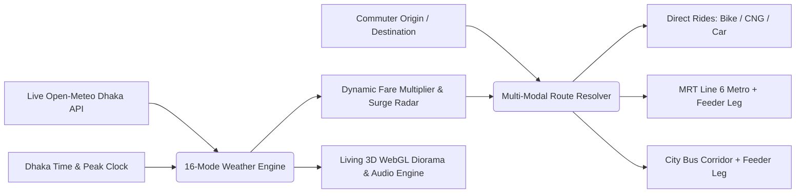

# 🚖 BharaDekhi — Dhaka Multi-Modal Transit Planner & Living City Simulator

<p align="center">
  
</p>

<p align="center">
  <a href="https://bharadekhi.vercel.app/"></a>
  <a href="https://bharadekhi.vercel.app/#/home"></a>
  <a href="https://bharadekhi.vercel.app/#/home"></a>
  <a href="https://leafletjs.com/"></a>
  <a href="https://tailwindcss.com/"></a>
</p>

---

## 🧭 Overview

> **BharaDekhi (ভাড়া দেখি)** is a production-grade, Dhaka-tailored multimodal transportation planning, fare estimation, and living city simulation web platform. 

It eliminates urban commuting uncertainty by bridging direct ride-hailing options (**Bike, CNG, Car**) with mass public transit networks (**MRT Line 6 Metro Rail**, **Local City Buses**, and **first-and-last-mile feeder connections**).

Powered by a dual-engine city simulation, commuters can experience Dhaka's iconic **Mirpur 10 Crossroads** in both **Interactive 3D WebGL (Three.js)** and **2D Responsive SVG**, synchronized with authentic **Procedural Web Audio soundscapes**, a **16-State Atmospheric Weather Engine**, and real-time **Bangladesh Daylight Astronomy**.

---

## 🔗 Quick Links

* 🌐 **Production Application:** [https://bharadekhi.vercel.app/](https://bharadekhi.vercel.app/)
* 🎮 **Interactive 3D City Diorama:** [https://bharadekhi.vercel.app/#/home](https://bharadekhi.vercel.app/#/home)
* 🗺️ **Multi-Modal Route Planner:** [https://bharadekhi.vercel.app/#/plan-trip](https://bharadekhi.vercel.app/#/plan-trip)
* ❓ **Interactive FAQ & Transit Guide:** [https://bharadekhi.vercel.app/faq.html](https://bharadekhi.vercel.app/faq.html)
* 👨‍💻 **Developer Portfolio:** [https://bharadekhi.vercel.app/about.html](https://bharadekhi.vercel.app/about.html)
* 💼 **LinkedIn Profile:** [Amiyo Hasan](https://www.linkedin.com/in/amiyo-hasan-6729873a7/)

---

## 🌟 Core System Highlights



---

### 1. 🌆 Dual-Engine Mirpur 10 Crossroads Simulation (`#/home`)

Commuters are greeted by a living miniature digital twin of Dhaka's most famous junction:

* **🎮 3D Drone Diorama (WebGL & Three.js):**
  * Full 3D architectural meshes: multi-story Dhaka storefronts, rooftop water storage tanks, hazard beacons, roadside trees, street lamps, and the elevated MRT-6 viaduct.
  * Interactive camera system: Smooth mouse-driven 3D parallax tracking, drone isometric perspective, and smooth orbit rotation.
  * Calibrated for ultra-fluid **120 FPS** performance with hardware-accelerated buffers and dynamic level-of-detail management.

* **📐 2D Flat Vector Mode:**
  * Clean, vector-sharp 2.5D illustration that preserves 100% aspect ratio across mobile phones (320px) to ultra-wide displays without clipping.
  * Instant, state-preserving toggle between **2D Flat** and **3D Drone** views via a single-click glass HUD pill.

* **🚥 4-Phase Coordinated Signal Engine:**
  * Real-time automated traffic cycles: `North-South Green` ➔ `North-South Yellow` ➔ `Pedestrians Crossing (All Stop)` ➔ `East-West Green` ➔ `East-West Yellow`.
  * Autonomous vehicle actors (Buses, CNG auto-rickshaws, private cars, motorbikes, human-powered rickshaws) queue realistically at stop lines and accelerate on green.
  * Moving pedestrians use marked zebra crossings during red halts under the elevated viaduct.

* **🚨 Emergency Priority Green Wave:**
  * One-tap emergency dispatch button clears the north-south transit corridor with animated visual flashing lights and an audible siren, signaling all cross-traffic to yield.

---

### 2. 🔊 Procedural Web Audio API Soundscape Engine

BharaDekhi generates authentic Dhaka acoustic soundscapes **100% programmatically** using the browser's native **Web Audio API** with **zero external audio files**:

* 🔔 **Rickshaw Bell Synthesizer:** Dual-frequency resonant metal chimes synthesized with authentic mechanical dual-strike harmonics.
* 🚗 **Dynamic Traffic Hum:** Pink/brown noise filters modulated by vehicle velocity, simulating approaching buses, idling CNG two-stroke engines, and accelerating cars.
* 🌧️ **Procedural Rainfall & Thunder Synthesizer:** White-noise frequency sculpting with bandpass filtering and dynamic gain staging, paired with low-frequency resonant thunder rolls.
* 🚇 **MRT-6 Spatial Station Chimes:** Pure-tone harmonic triads played when metro trains glide into Mirpur 10 Station.
* 🎚️ **Zero-Friction User Control:** Master mute/unmute toggle in the HUD with automatic tab-visibility pausing to conserve CPU resources.

---

### 3. ⛅ 16-State Atmospheric Weather Engine & Bangladesh Seasonal Automator

The visual environment, lighting, shadows, and transit surge multipliers dynamically adapt across 16 atmospheric modes:

| Mode # | Mode Identifier | Atmospheric & Lighting Specification |
| :---: | :--- | :--- |
| **01** | `Auto Weather (...)` | **Live Open-Meteo Dhaka API** (`23.8103, 90.4125`) + Bangladesh shifting daylight equinox engine. |
| **02** | `Force Sunrise / Early Morning (Clear)` | Golden dawn horizon glow, long low-angle shadows, soft diffused daylight. |
| **03** | `Force Sunrise Overcast / Stormy` | Bruised slate clouds with muted rose morning horizon backlight. |
| **04** | `Force Sunrise Foggy` | Pale amber dawn haze with rolling ground mist and diffused light. |
| **05** | `Force Morning Overcast / Stormy` | Heavy pre-storm gloomy sky, slate clouds, early building window lighting. |
| **06** | `Force Sunny / Day` | High-noon solar illumination, crisp high-contrast geometry, clear skies. |
| **07** | `Force Day Overcast / Stormy` | Dark ash overcast with heavy atmospheric gloom and active downlights. |
| **08** | `Force Sunset / Evening (Clear)` | Golden-hour amber/copper sky with lengthening dusk shadows. |
| **09** | `Force Sunset / Evening Overcast / Stormy` | Bruised dusk sky, copper horizon strip, streetlamps turning on. |
| **10** | `Force Evening Foggy` | Dusk twilight haze with glowing streetlamp halos cutting through mist. |
| **11** | `Force Night` | Deep midnight blue sky, crescent moon, twinkling stars, vivid neon storefronts. |
| **12** | `Force Night Overcast / Stormy` | Storm clouds with high-contrast neon signs, vehicle headlights, and porch downlights. |
| **13** | `Force Foggy (Day)` | High-visibility daylight fog with rolling river mist bands. |
| **14** | `Force Foggy (Night)` | Cinematic night smog with vibrant vehicle headlight beams and halos. |
| **15** | `Force Rain (+30%)` | Falling rain canvas, lightning sky flashes, wet street puddles, +30%–50% rain surge. |
| **16** | `Dry / Normal` | Standard dry baseline mode with default road traction and pricing. |

* **Custom Glassmorphic Selector:**
  * Height clamped to **5 visible items** (`max-h-[190px]`) with a custom frosted glowing cyan glass scrollbar.
  * Responsive viewport bounds protection keeps the dropdown anchored neatly beneath the button on both mobile (320px–420px) and wide desktop displays.

---

### 4. 🗺️ Multi-Modal Trip Planner & Transit Comparison (`#/plan-trip`)

* **Flexible Geocoding:** Search locations with autocomplete, tap anywhere on the Leaflet map, use browser geolocation, or launch one-click corridor shortcuts (*Uttara ⇄ Motijheel*, *Mirpur 10 ⇄ Dhanmondi*, *Farmgate ⇄ Gulshan*).
* **OSRM Routing with Haversine Fallback:** Computes actual turn-by-turn road geometry and travel duration, backed by a resilient mathematical Haversine trigonometric fallback.
* **Animated Route Playback:** Smooth camera tracking and vehicle marker progression with real-time heading angle rotation along Dhaka's roads.
* **"More Ways to Travel" Comparison Cards:**
  * **MRT Line 6 Metro Card:** Exact station-to-station ticket calculations based on official MRT fare charts (৳20 min, ৳100 max) with optional **10% MRT Pass discount** toggle.
  * **Local City Bus Card:** Comprehensive Dhaka bus corridor database with BRTA distance fare progression (৳10 min, ৳2.70/km).
  * **Feeder Leg Optimizer:** Connects your origin and destination to the nearest transit hubs via customizable first/last-mile feeder modes (**Rickshaw, CNG, Bike, Car**), displaying the complete combined journey fare and time.
* **Peak Surge Radar:** Time-aware rush hour multiplier (1.4x – 2.2x) calculated from local Dhaka time (`Asia/Dhaka`: 8:30–10:30 AM, 5:00–8:00 PM).

---

## 🛠️ Technology Stack

| Domain | Technology | Implementation Purpose |
| :--- | :--- | :--- |
| **3D Graphics & WebGL** | [Three.js](https://threejs.org/) (r128) | Procedural 3D diorama meshes, lighting, shadows, orbit camera, 120 FPS diorama |
| **Vector Animation** | SVG, Canvas 2D, CSS `@keyframes` | 2D Crossroads simulation, weather precipitation canvas, animated train viaduct |
| **Audio Synthesis** | Native [Web Audio API](https://developer.mozilla.org/en-US/docs/Web/API/Web_Audio_API) | Procedural rickshaw bells, traffic hum, rain noise synthesizer, MRT-6 chimes |
| **Frontend Framework** | Pure Vanilla ES6+ JavaScript | Zero build dependencies, instantaneous page loads, client-side hash routing (`#/home`, `#/plan-trip`) |
| **Styling & Design** | [Tailwind CSS](https://tailwindcss.com/), Glassmorphism | Custom dark/light palettes, frosted glass scrollbars, responsive flex layouts |
| **Mapping & Geospatial** | [Leaflet.js](https://leafletjs.com/) (v1.9.4), CartoDB Tiles | Themed dark/light tile layers, SVG vehicle pins, animated route polylines |
| **Routing Engines** | [Project OSRM](https://project-osrm.org/), Haversine Math | Real Dhaka road paths, distance matrix, zero-downtime spherical fallback |
| **External APIs** | [Open-Meteo API](https://open-meteo.com/) | Live central Dhaka weather codes (`weathercode`), precipitation rates |
| **Database & Auth** | [Supabase](https://supabase.com/) (`@supabase/supabase-js` v2), PostgreSQL | User authentication, session persistence, Row-Level Security (RLS) |
| **CI/CD & Hosting** | [Vercel](https://vercel.com/) | Automated Git-driven edge deployments |

---

## 📐 Baseline Fare Calculation Formula

| Mode | Base Fare | Per-KM Rate | Speed Profile | Weather & Surge Multiplier |
| :--- | :---: | :---: | :--- | :--- |
| **🏍️ Bike** | ৳30 | ৳14 / km | 18 km/h (Peak) / 24 km/h | 1.4x–2.2x Rush hour · +30%–50% Rain surge |
| **🛺 CNG Auto-Rickshaw** | ৳50 | ৳18 / km | 12 km/h (Peak) / 18 km/h | 1.4x–2.2x Rush hour · +30%–50% Rain surge |
| **🚗 Car (Sedan)** | ৳80 | ৳24 / km | 15 km/h (Peak) / 22 km/h | 1.4x–2.2x Rush hour · +30%–50% Rain surge |
| **🚲 Feeder Rickshaw** | ৳20 | ৳12 / km *(৳10 steps)* | 12 km/h | Peak adds ৳10 to upper range; +30%–50% Rain |
| **🚇 MRT Line 6 Metro** | ৳20 | Station matrix *(max ৳100)* | 2 min/station + 5 min wait | Fixed official fare; **10% MRT Pass discount** |
| **🚌 Local City Bus** | ৳10 | ৳2.70 / km | BRTA Distance Scale | Distance-based BRTA scale; immune to surge |

---

## 💻 Local Quickstart

Setup takes under 30 seconds with **zero npm packages or compilation steps required**:

```bash
# 1. Clone the repository
git clone https://github.com/AmiyoTheAnalyst/BharaDekhi.git
cd BharaDekhi

# 2. Start a local server (any of the following):
# Using Python 3:
python -m http.server 8000

# Or using Node.js:
npx serve .
```

Visit `http://localhost:8000` in your browser.

---

## 📂 Repository File Architecture

```
commute-dhaka-web/
├── assets/
│   ├── bharadekhi-mark.svg           # Official vector brand logo
│   ├── crossroads-3d.js              # Three.js 3D diorama engine & procedural meshes
│   ├── dhaka-bus-routes.json         # Dhaka city bus route network database
│   ├── readme-banner.svg             # Animated vector banner for GitHub
│   └── three.min.js                  # Production Three.js WebGL runtime (r128)
├── supabase/
│   └── schema.sql                    # PostgreSQL schema, auth & RLS security rules
├── index.html                        # Core SPA application (Crossroads, Planner, Soundscape)
├── about.html                        # Developer portfolio & engineering skills matrix
├── faq.html                          # Interactive commuter help center & FAQ accordion
├── favicon.png                       # High-resolution application favicon
├── robots.txt                        # Search engine optimization indexing rules
├── sitemap.xml                       # XML Sitemap for search indexing
└── README.md                         # Project documentation
```

---

## 👨‍💻 Author & Profile

**Amiyo Hasan**  
*Creator of BharaDekhi · Full-Stack Software Engineer & Data Analyst*  
*B.Sc. in Computer Science & Engineering (B.Sc. CSE), BRAC University*  

* 🌐 **Portfolio Website:** [https://bharadekhi.vercel.app/about.html](https://bharadekhi.vercel.app/about.html)
* 💼 **LinkedIn Profile:** [https://www.linkedin.com/in/amiyo-hasan-6729873a7/](https://www.linkedin.com/in/amiyo-hasan-6729873a7/)
* 🐙 **GitHub Profile:** [@AmiyoTheAnalyst](https://github.com/AmiyoTheAnalyst)
* 📧 **Email:** [amiyohasan23@gmail.com](mailto:amiyohasan23@gmail.com)

---

## 📄 License & Attributions

* **License:** Open web practices for Dhaka commuters.
* **Cartography:** © [OpenStreetMap](https://www.openstreetmap.org/copyright) contributors, [CartoDB](https://carto.com/).
* **Routing Services:** [Project OSRM](https://project-osrm.org/).
* **Weather Data:** [Open-Meteo.com](https://open-meteo.com/) (CC BY 4.0).
* **Transit Guidelines:** Bangladesh Road Transport Authority (BRTA) & Dhaka Mass Transit Company Limited (DMTCL).
